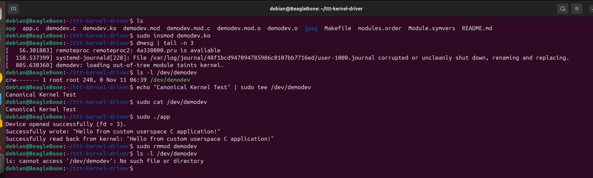

# Linux Character Device Driver (`linux-chardev-kernel-driver`)

An out-of-tree Linux character device driver (`demodev`) built for the BeagleBone Black running Debian, demonstrating a static buffer character device lifecycle, `file_operations` handlers, and userspace integration.

## Architecture Overview
- **Major Number Allocation:** Dynamically requests a major device number using `alloc_chrdev_region()`.
- **Sysfs Integration:** Automatically creates the device node `/dev/demodev` via `class_create()` and `device_create()`.
- **Static Storage:** Utilizes a static kernel buffer array to store and retrieve data written from userspace.

## Build Instructions

1. Install matching kernel build headers:
   ```bash
   sudo apt update
   sudo apt install build-essential linux-headers-$(uname -r)
Compile the kernel module and userspace app:

Bash
make
gcc app.c -o app
Testing & Usage Lifecycle
Insert the Module:

Bash
sudo insmod demodev.ko
Verify: Run 
dmesg | tail -n 3
to confirm initialization and check that /dev/demodev was created 
ls -l /dev/demodev

Test Write & Read (via CLI or App):

Bash
echo "Canonical Kernel Test" | sudo tee /dev/demodev
sudo cat /dev/demodev

Alternatively, run your compiled userspace application:

Bash
sudo ./app
Result:


Remove the Module:

Bash
sudo rmmod demodev
Verify: Confirm /dev/demodev is automatically removed and check dmesg | tail -n 2 for the exit message.
